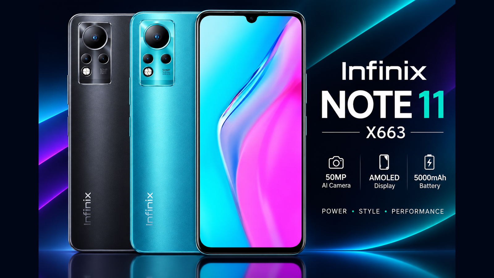

# 📦 Vendor Blobs for Infinix Note 11 (X663)

**Vendor repository for the Infinix Note 11 — MediaTek Helio G88 - MT6768 / MT6769H, Android 12.**

<p align="center">
  
</p>

---

## Device Specifications

| | |
| --- | --- |
| **Model** | Infinix Note 11 (X663) |
| **SoC** | MediaTek MT6768 / Helio G88 (MT6769H) (2× Cortex-A75 + 6× Cortex-A55) |
| **Display** | 6.7" 1080×2400, 393 dpi, 60 Hz |
| **Stock ROM** | XOS 10.6.0, Android 12, `X663-H6915ABCEFGHIO-S-GL-230918V670` |
| **Partitions** | Virtual A/B, dynamic (`system`, `system_ext`, `product`, `vendor`) |
| **First API level** | 30 |
| **Vendor VNDK** | 31 |

## 🚦 Current State / Status

- **Compilation**: **Build completed successfully** (`lineage-19.1` compiles cleanly to flashable zip via `mka bacon`).
- **Boot Status**: **Stuck at splash screen** (device reaches the initial Infinix boot splash logo, currently under active bring-up / early init debugging).

## 🔨 Build

Build with the official LineageOS guide, cloning the device and vendor repositories into the source tree:

```bash
mkdir -p ~/android/lineage
cd ~/android/lineage

repo init -u https://github.com/LineageOS/android.git -b lineage-19.1 --git-lfs
repo sync -c -j$(nproc --all) --force-sync --no-clone-bundle --no-tags

git clone https://github.com/ALBINsRAJ2025/android_device_infinix_X663 \
    -b lineage-19.1 device/infinix/X663
git clone https://github.com/ALBINsRAJ2025/android_vendor_infinix_X663 \
    -b lineage-19.1 vendor/infinix/X663

source build/envsetup.sh
lunch lineage_X663-userdebug
mka bacon -j$(nproc --all)
```

## ⚖️ Licensing

Original makefiles, scripts, and documentation are licensed under **Apache-2.0** (see `LICENSE` and `NOTICE`).
